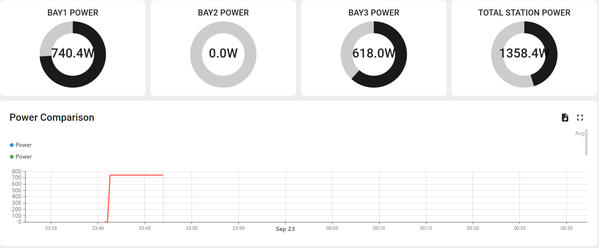
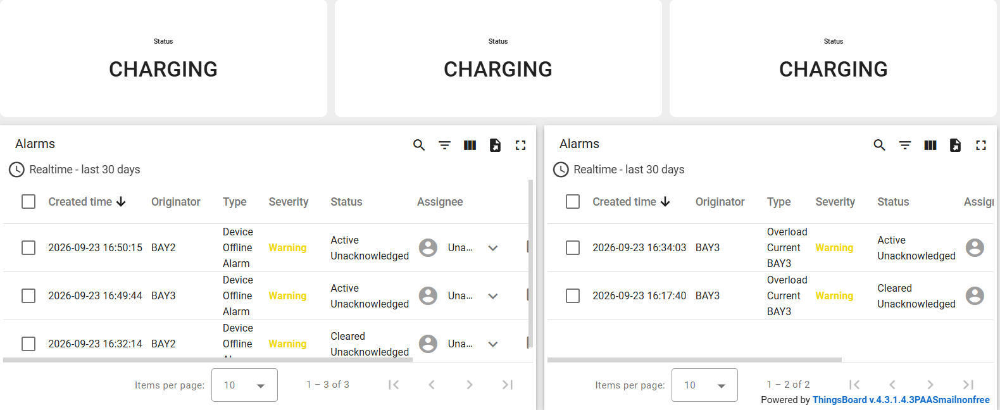
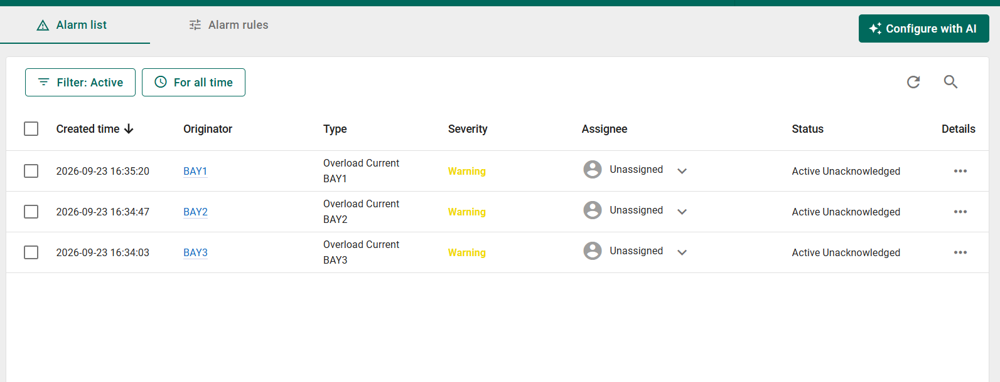

# Edge AI-Based EV Charging Station

An IoT project that simulates a three-bay EV charging station. Each bay runs on an ESP32 (simulated in [Wokwi](https://wokwi.com/)), reads its own sensors, predicts demand on the device, and reports to a [ThingsBoard](https://thingsboard.cloud/) cloud dashboard with remote control and overload alarms.

## What the system does

1. **Sense**: voltage, current, temperature and plug-in/plug-out status for each bay.
2. **Predict**: an on-device model estimates arrival probability and charging duration.
3. **Decide**: local logic picks a load decision (allow, standby, throttle) and drives status LEDs.
4. **Publish**: telemetry goes to ThingsBoard over MQTT every 5 seconds.
5. **Control**: relay on/off and throttle level can be set from the dashboard through RPC buttons.
6. **Alert**: each bay has an overload alarm that fires when current goes above 16 A and clears when it drops back.

A combined Charging Station dashboard shows total station power across all three bays.

## Hardware (simulated)

| Part | Pin | Purpose |
|------|-----|---------|
| Potentiometer | 34 | Simulated voltage sensor |
| Potentiometer | 35 | Simulated current sensor |
| DHT22 | 15 | Temperature |
| Relay | 26 | Switches the charger |
| Push button | 32 | Plug in |
| Push button | 33 | Plug out |
| LED green / yellow / red | 18 / 19 / 21 | Free / charging / alarm |

## Dashboards

Each bay has its own ThingsBoard dashboard (voltage, current, power, temperature, bay status, load decision, AI predictions and the RPC buttons). A separate Charging Station dashboard shows total power across the three bays, per-bay status and the alarm tables.





### Overload alarms

Each bay has an alarm rule on its device that raises a warning when current goes above 16 A and clears when it drops below 16 A.



## Repository layout

```
BAY1/ BAY2/ BAY3/
  include/          headers (pins, shared state, module interfaces)
  src/              firmware source
  test/             Wokwi circuit (diagram.json, wokwi.toml)
  platformio.ini
docs/
  EV_Charging_Station_Presentation.pptx
  screenshots/
```

All three bays run the same firmware. Only the device token and bay ID differ.

## Tech stack

ESP32, C++ (Arduino framework), PlatformIO, Wokwi, MQTT (PubSubClient), ArduinoJson, ThingsBoard Cloud.

## Setup

1. Install [VS Code](https://code.visualstudio.com/) with the **PlatformIO** and **Wokwi** extensions.
2. In each bay's `src/` folder, copy `config.example.cpp` to `config.cpp`.
3. Create a device in ThingsBoard for each bay and paste its access token into that bay's `config.cpp` in place of `YOUR_THINGSBOARD_DEVICE_TOKEN`. Set `BAY_ID` to `BAY1`, `BAY2` or `BAY3`.
4. Build with PlatformIO, then start the simulation with Wokwi.

`config.cpp` holds your credentials and is listed in `.gitignore`, so it is never committed.
